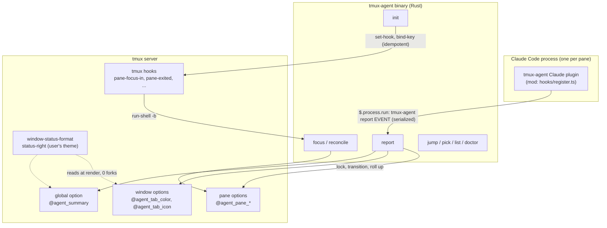
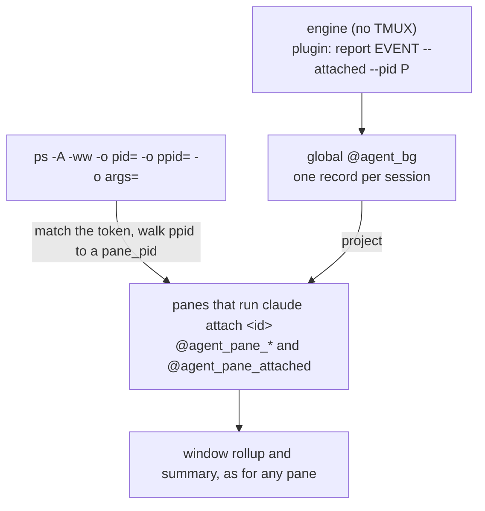

# tmux-agent design

Show the status of Claude Code agents on tmux window tabs, so you can see at a glance which windows need you.

Prior art and the reasoning behind many choices below: [research.md](research.md).

## Goals

- Recolour each window tab, and add an icon, by the most urgent agent state of any pane in that window.
- Priority: **needs-input > done (unseen) > working > idle**. Idle shows nothing.
- Run on macOS and Linux, with tmux on a remote host reached over SSH.
- Never rewrite the user's theme formats. Publish tmux options that the theme reads.
- Cost no forks per status refresh for the tab state.

## Non-goals

- Desktop notifications, sounds and terminal bells. tmux runs remotely, so none of these would reach the user.
- Agents other than Claude Code.
- Agents with no tmux pane: other terminals, IDEs, the desktop app, and `claude -p` scripts. A background session counts as having a pane while some pane runs `claude attach` for it (see Background sessions).
- TPM install.

## States

| State | Meaning | Tab | Rank |
|---|---|---|---|
| `needs-input` | A permission prompt, a question, plan approval or an elicitation dialog is open, or the turn ended on an API error | red, icon | 3 |
| `done` | The turn finished, no background work remains, and the user has not focused the pane since | green, icon | 2 |
| `working` | A turn is running, or background work the session owns is still running | yellow, icon | 1 |
| `idle` | Seen done, seen error, cancelled, or a session with no prompt yet | theme default, no icon | 0 |
| (none) | No agent in the pane | theme default | – |

A window shows the state of its highest-ranked pane. All panes count, including panes hidden by a zoom.

### Seen

**Seen** means tmux fired `pane-focus-in` for the pane. With `focus-events on`, that hook fires on `select-pane`, `select-window`, `switch-client`, attach, and when the terminal regains focus. Focusing a `done` or error `needs-input` pane turns it `idle`. Focusing a pane with an open prompt changes nothing, because the prompt still needs an answer.

A `done` that arrives while its pane is already focused goes straight to `idle`. "Focused" means some row of `list-clients -F '#{pane_id}\t#{client_flags}'` has that pane and its flags contain `focused`. `session_attached`, `window_active` and `pane_active` are not used: they are true for sessions that nobody is looking at.

### Transitions

The binary keeps two facts per pane:
- the **loop** state: `idle`, `working`, `done` or `error`;
- an **asks** flag, true while the plugin reports at least one open prompt.

The displayed state is `needs-input` if asks is set or the loop is `error`. Otherwise it is the loop state.

| Event | Loop after | Asks after | Notes |
|---|---|---|---|
| `claim`, pane unowned or owner dead | `idle` | off | takes ownership; bg = 0 |
| `claim`, same owner | unchanged | unchanged | Sent again on a plugin reload or worker respawn, which can happen mid-turn. Refreshes the owner fields only. |
| `reset` | `idle` | off | `/clear` or an in-process resume; bg = 0 |
| `working` | `working` | unchanged | bg = 0 |
| `ask` | unchanged | on | |
| `resume` | `working` if `done` or `idle`, else unchanged | off | |
| `done --bg N`, N > 0 | `working` | unchanged | stores bg = N |
| `done`, bg 0, pane focused | `idle` | unchanged | |
| `done`, bg 0 | `done` | unchanged | Shows `needs-input` while asks is on. |
| `error` | `error` | unchanged | |
| `cancel` | `idle` | off | Esc: the user is at the pane |
| `focus` | `done` → `idle`, `error` → `idle`, else unchanged | unchanged | |
| `release` | cleared | cleared | Clears all `@agent_pane_*` options |

Reports from a pane's non-owner are dropped (see Ownership). The unit tests enumerate this table.

## Architecture



There are two parts:

1. **The Claude plugin** (`plugin/`, TypeScript). It is a mod: it hooks Claude Code's in-process plugin API, tracks open prompts and background work, and sends a small vocabulary of reports to the binary. The transitions and everything tmux-related stay in Rust, where they are testable.
2. **The `tmux-agent` binary** (Rust). It owns ownership checks, transitions, the window rollup, focus handling, cleanup, navigation and tmux setup.

### Why the plugin API and not `settings.json` hooks

- `turn.complete` carries `reason` (`answer`, `refusal`, `aborted`, `error`) and `isAborted`. An Esc cancel is detected, including Esc during a Bash call, where neither `Stop` nor `PostToolUse` fires.
- `classic.<Event>` hooks deliver the same payloads as `settings.json` hooks (`PermissionRequest`, `Notification`, `PreToolUse`, `Stop`, ...) without editing `settings.json`.
- `classic.Stop` carries `background_tasks`. Each entry has a type of `shell`, `subagent`, `workflow`, `monitor` or `session_crons`, which counts background Bash too. `$.agent.list()` does not include background Bash.
- `session.start` exposes `surface` and `isInteractive`, so `claude -p` and non-terminal surfaces are skipped at the source.
- `session.end` carries a reason, so `/clear` and resume can be told apart from exit.

## The Claude plugin

### Activation

The plugin acts only when `session.start` reports `surface === 'terminal'` and `isInteractive`. Otherwise every hook only calls `next(e)`.

- If `$.env.get('TMUX')` and `$.env.get('TMUX_PANE')` are both set, it reports for that pane (`--pane`, `--socket`). A malformed `TMUX` or pane id turns it off, and so does only one of the two being set.
- If neither is set, it reports as an **attached** session (`--attached`, no pane): see Background sessions (claude attach). The binary keeps a record only for an engine that Claude's daemon hosts, and decides which panes, if any, show it. An attached report also carries `--claude-dir`: `$CLAUDE_CONFIG_DIR`, else `$HOME/.claude`, if absolute (see Fleet viewers).

### Hook discipline

- Each event gets its own literal `on('<event>', ...)`. The handlers call shared plain helpers.
- Every hook calls `next(e)` without waiting for tmux, and each classic hook has a `.catch` that falls through to `next(e)`.
- Reports go through one promise chain: `q = q.then(() => $.process.run(argv, { timeoutMs })).catch(() => {})`. This gives a total order per Claude process. No hook awaits the chain, except `session.end`, which awaits its final report within the hook's remaining budget.
- Every report passes `--proto 1`. The binary ignores unknown events and flags and exits 0, so a newer plugin with an older binary degrades quietly.

### Identity

- **Pane and socket**: `TMUX_PANE`, and the socket path parsed from `TMUX`, passed as `--pane` and `--socket`. With no tmux environment, `--attached` instead.
- **Owner PID**: `$.process.run(['sh', '-c', 'echo $PPID'])` at `session.start`. This returns the Claude engine process, verified on 2.1.316. It is not `#{pane_pid}` and not the ASBX wrapper.
- **Session id**: `$.session.id()`, read at each report, because it changes on `/clear`. It is used for display only.

### Event mapping

| Plugin event | Condition | Action |
|---|---|---|
| `session.start` | active (see Activation) | report `claim --pid P` |
| `turn.start` | main thread (no `agentId`) | clear asks for the main thread; bg = 0; report `working` |
| `classic.PermissionRequest` | any agent, including subagents | open an ask keyed by `(agent_id ?? main, tool_name, hash(tool_input))` |
| `classic.PreToolUse` | tool `AskUserQuestion` or `ExitPlanMode` | open an ask keyed by `(*, tool, hash(input))`. The envelope carries no agent_id, so it matches any agent. |
| `classic.Notification` | `elicitation_dialog`, `elicitation_url_dialog`, `agent_needs_input`, `worker_permission_prompt` | open an ask keyed by `(agent_id ?? main, notification_type)` |
| `classic.Notification` | `permission_prompt` | confirm an existing ask only; never open one |
| `classic.PostToolUse`, `PostToolUseFailure`, `PermissionDenied` | | close the matching ask |
| `classic.ElicitationResult`, Notification `elicitation_complete` or `elicitation_response` | | close that agent's elicitation ask |
| `classic.UserPromptSubmit` | | close all asks |
| `turn.start` / `turn.complete` | an agent with `agentId` | close that agent's asks |
| `classic.Stop` | main thread (`agent_id` undefined) | bg = count of `background_tasks` with type `shell`, `subagent` or `workflow` |
| `turn.complete` | main, reason `aborted` | close all asks; report `cancel` |
| `turn.complete` | main, reason `error` | report `error` |
| `turn.complete` | main, reason `answer` or `refusal` | report `done --bg N` |
| `turn.complete` | a background agent's turn (fallback) | Only for agentIds seen in `$.agent.list()`. After 250 ms, if the main thread is not running and no listed agent is `pending`, `running` or `waiting` (teammates excluded), report `done`. |
| `session.end` | reason `clear` or `resume` | report `reset` |
| `session.end` | any other reason | report `release`, awaited |

`monitor` and `session_crons` background tasks are not counted, because they are long-lived and would pin the pane on `working`.

### Asks and the grace delay

- Each ask has its own `$.clock.after(graceMs)` timer; the default is 1000 ms.
- When the first ask's timer fires and the set is still non-empty, the plugin reports `ask`.
- When the set becomes empty after `ask` was reported, the plugin reports `resume`.
- Dialogs answered within the grace delay never show.

These rules follow from the events Claude sends:
- Auto-mode classifier decisions never raise `PermissionRequest`, so they never show.
- `idle_prompt` is not in the Notification allowlist. It fires about 60 seconds after a turn ends and would turn `done` into `needs-input`.
- `PermissionDenied` is an auto-mode denial. It closes the matching ask.

**Known gap:** an approved tool that runs longer than the grace delay shows red until it ends, because `PostToolUse` is the first event after approval. Verified live: `tool.check` resolves `ask` and the `PermissionRequest` chain resolves within milliseconds, before the person answers, and `turn.step` streams only the model's response. No hook marks the approval itself.

### Background work

| Kind | Handling |
|---|---|
| Foreground subagents (Task tool) | Roll into the parent pane. Their prompts open asks. Their turn ends only close their own asks. |
| Background subagents, workflows, background Bash | Counted from `Stop.background_tasks`. The main turn's end then shows `working`. When the work finishes, Claude wakes the main thread (verified for Bash and workflows), and that turn's end reports `done`. The agent-turn fallback runs only when all the background work is subagents. A workflow's own agents end their turns while the workflow runs on, and `$.agent.list()` does not list them, so a fallback on their turns ended a running workflow early (seen live). |
| `claude -p` in a pane | Ignored: `isInteractive` is false. |
| A nested interactive `claude` in a pane already owned | Its `claim` is refused while the owner lives (see Ownership). |
| A background session (Claude's daemon) viewed with `claude attach` in a pane | Reported `--attached`. Shown on each pane that runs `claude attach` for it (see Background sessions). |
| A background session viewed in the fleet view of the pane's own Claude, after the left-arrow handoff or `/fork` | Reported `--attached`. Shown on that pane while the pane title names it (see Fleet viewers). |
| Other interactive agents outside tmux (a terminal, an IDE) | Reported `--attached` too, as the plugin cannot tell them apart. The binary ignores them: no daemon pty host is their parent, so they get no record and cost no `ps` call after that report. |

### Settings

Plugin `userConfig`:
- `binary`: the default is `tmux-agent` on PATH. The Nix-built plugin substitutes an absolute path.
- `graceMs`: the default is 1000.

## The binary

### State storage

All state lives in tmux options, so it dies with the pane, the window or the server. tmux-resurrect and continuum do not restore `@` options. Pane and window options use different names, because a pane option with no value falls back to the window option of the same name.

| Scope | Option | Value |
|---|---|---|
| pane | `@agent_pane_state` | displayed state: `needs-input`, `done`, `working`, `idle` |
| pane | `@agent_pane_loop`, `@agent_pane_asks` | `idle`/`working`/`done`/`error`, and `0`/`1` |
| pane | `@agent_pane_pid`, `@agent_pane_pid_start` | owner PID and its process start time |
| pane | `@agent_pane_session` | Claude session id, for display |
| pane | `@agent_pane_since` | epoch seconds of the last change to the displayed state |
| pane | `@agent_pane_bg` | background work count |
| pane | `@agent_pane_proto`, `@agent_pane_plugin` | protocol and plugin version, for `doctor` |
| pane | `@agent_pane_attached` | short id of the background session the pane shows; unset for a session in the pane |
| window | `@agent_window_state` | rolled-up state |
| window | `@agent_tab_color` | literal colour for the rolled-up state, or unset |
| window | `@agent_tab_icon` | icon plus a trailing space, or unset |
| global | `@agent_summary` | e.g. `󰂞 1  2  3`, or empty |
| global | `@agent_bin`, `@agent_version` | the binary path that hooks run, and its version |
| global | `@agent_bg` | background session records (see Background sessions); a copy sits in `<canonical socket path>.tmux-agent.bg` |

### Writes and races

Each `report`, `focus` and `reconcile` locks `<canonical socket path>.tmux-agent.lock`. The file sits beside the socket, in tmux's 0700 directory, and is locked with `std::fs::File::lock` (Rust 1.89+). Under the lock the command:

1. reads the config, all panes (`list-panes -a`), all clients (`list-clients`) and `@agent_bg` in one tmux call;
2. applies the pure transition function;
3. writes the pane options, the changed window rollups and the summary in one `;`-chained tmux call.

The lock gives mutual exclusion, so two panes in one window that report at the same moment cannot leave a stale rollup. The ordering of one pane's reports comes from the plugin's promise chain. Each pane has one writer.

### Ownership

- The owner is the Claude engine PID plus its start time. The start time comes from `proc_pidinfo` on macOS and `/proc/<pid>/stat` on Linux.
- The owner is alive unless `kill(pid, 0)` returns `ESRCH` or the start time differs. `EPERM` counts as alive.
- A report from the owner PID is accepted whatever its session id.
- A report from another PID is dropped while the owner is alive, including `claim`. A `release` from a non-owner does nothing.
- If the pane is unowned or its owner is dead, any report counts as an implicit `claim` first.

### Cleanup

| Trigger | Action |
|---|---|
| `session.end` | `release`, or `reset` for `/clear` and resume |
| tmux `pane-exited`, `pane-died`, `after-kill-pane`, `window-layout-changed`, `window-linked`, `window-unlinked`, `session-closed` | full `reconcile` |
| break, join, swap and move-pane | Pane options travel with the pane. The layout and link hooks run `reconcile`, which recomputes both windows. |
| `respawn-pane -k`, a Claude crash, or `kill -9` | No hook fires. `reconcile` finds the owner dead and clears the pane. |

`reconcile` recomputes every window's rollup from its current panes. It unsets the window options on windows with no stateful panes, and drops the state of panes whose owner is dead. While a background session record exists, it also finds the panes that show each one (see Background sessions). It exits early when the pane→window→state map has not changed. It runs:
- on `client-attached`;
- after every `focus`;
- before `jump`, `pick` and `list`;
- once per `status-interval`, through the `#(#{@agent_bin} reconcile)` token in the status-right snippet. That costs one fork per refresh, and the command prints nothing.

## Background sessions (claude attach)

Claude Code can run a session in a background daemon. The process tree, seen live on macOS with Claude 2.1.316:

```
claude daemon run --origin transient ...                      (ppid 1)
└─ claude --bg-pty-host <sock> ... -- claude --session-id <id>
   └─ claude --session-id <id> --fork-session ...               the engine: the plugin runs here
pane %3: zsh → claude attach 686fd2bf → .../bin/claude attach 686fd2bf → .../claude attach 686fd2bf
```

The engine has no `TMUX` or `TMUX_PANE`, and a terminal attach raises no `session.attach` event (that event is only for remote stream-json surfaces), so the plugin cannot know which pane shows it, or when that changes. The binary works it out instead.



**Reports.** `report <event> --attached --pid P` (no `--pane`):
- The server is `--socket`, else the one in `$TMUX`, else tmux's default: `$TMUX_TMPDIR` (or `/tmp`), then `tmux-<uid>/default`, with the directory resolved by `realpath` as tmux does (`/tmp` is `/private/tmp` on macOS). The lock canonicalizes the same path, so every writer agrees.
- P must be a live process whose parent's argv (before any `--`) holds `--bg-pty-host`: an engine that Claude's daemon hosts, including a pre-warmed spare (`claude bg-spare`). Any other P, a report with no `--pid`, or a failed `ps` leaves no record. So a plain `claude` in a terminal outside tmux costs one `ps` call per report and nothing after.
- The session id is one of: the value after `--session-id` (or `--session-id=`) in P's argv, the id of P's live record, then `--session`. The first that some `claude attach` token names wins, else the first in that order. P's live record under another id is renamed to it. After `/clear` the reported id changes but the attach key does not; a spare engine has no `--session-id`, so its record keeps the id it first reported until a client names another. Its first eight characters are its **short id**.
- The transition applies to the session's record, under the same ownership rules as a pane: the owner is the engine PID plus its start time.

**Records.** `@agent_bg` holds one record per session, space-separated; each is `id|loop|asks|bg|pid|pid_start|since|session|proto|plugin`, plus `|claude_dir` once the engine reported one. Fields never hold a space, `|`, tab or newline; the config dir is written with `%XX` for those and `%`. A record with no config dir keeps ten fields, so an older binary still reads it. One global option rather than one per session, because it reads through the snapshot's existing `list-sessions` format, with no `show-options` output to parse and nothing to read when no records exist.

**Finding the panes.** One `ps -A -ww -o pid= -o ppid= -o args=` call (retried without `-ww` if `ps` rejects it, as BusyBox does), made only for `report --attached` or while a record exists:
- A client is a process whose command is a word with the file name `claude`, and whose first non-option word after it (before any `--`) is `attach`, followed by a token. The command is argv0; or the script a launcher runs (`/bin/sh ./claude`, `node /usr/local/bin/claude`, `/usr/bin/env claude`); or, for an absolute argv0 path that holds spaces, such as `.../Application Support/...`, the word that ends it, within the first four words and with no option before it. That excludes `tmux attach`, `git attach`, `sh -c "claude attach …"` (its child is the client), wrappers named otherwise, and an engine whose arguments mention the words.
- The token names a session when it is at least eight characters long and the session id starts with it.
- From each client, the walk follows ppid until it reaches a `#{pane_pid}`, the client itself included. It is bounded by the table size, so a PID cycle ends.

**Projection.** After every command, under the lock:
1. Records whose owner is dead are deleted.
2. Each pane that shows a session gets the record's state, with `@agent_pane_attached` set to the short id. A pane with a live session of its own (no marker) keeps it, unless its owner is the fleet viewer that shows the session (see Fleet viewers). A pane report on a pane that only shows a background session takes the pane.
3. A marked pane that no longer shows a session, or whose record is gone, is cleared.
4. Rollups and the summary follow, as for any pane. A session attached in two panes counts in each pane's window, but once in the summary: the summary counts one per short id among marked panes.

**When.** `report --attached` and `reconcile` find the panes with `ps`. `reconcile` runs every `status-interval`, so attach and detach show within one interval. `focus` and pane reports use the markers instead, with no fork. With no records, nothing forks.

**Seen.** `focus` on a marked pane marks the session's record seen, so `done` turns `idle` on all its panes. A `done` that arrives while any of its panes is focused goes straight to `idle`.

**Release.** `release` deletes the record and clears its panes. `reset`, `claim` and the rest act as for a pane.

**Server restart.** The daemon's engines outlive the tmux server, and a new server raises no event they see, so a session at `done` or waiting on input would report nothing more. Each command that changes `@agent_bg` therefore also writes it, after the tmux write succeeds and still under the lock, to `<canonical socket path>.tmux-agent.bg` (to a temporary file, then renamed), and removes the file when no records remain. When `@agent_bg` is empty, a command reads the file: after a restart, the first `reconcile` takes the records back, drops those whose owner died meanwhile, and projects the rest onto the new panes that run `claude attach`, within one status interval. With no file this is one failed `open`, no fork.

**Limits.**
- The plugin cannot tell a daemon session from an interactive session in a terminal outside tmux. Both report `--attached`, to the default server; the binary keeps a record only for the first (see Reports).
- A token shorter than eight characters never matches.
- A spare engine's attach key is assumed to be the first session id it reports, or one a client names; not checked against a live claimed spare.
- With no working `ps`, no pane ever shows a background session. `doctor` warns when records exist and the scan fails.

### Fleet viewers

The left-arrow handoff on an empty prompt sends the session to the background, and `/fork` inside a background job forks it there too. Then the pane's own Claude process shows daemon jobs in its **fleet view**: a list of jobs, where Enter attaches to one and a left arrow detaches. No `claude attach` process runs. Seen live on Linux with Claude 2.1.316:

```
pane %25: fish → claude --resume → .../claude (P, the pane's owner: now the viewer)
                                    └─ claude daemon run --origin transient --spawned-by {"pid":P}
                                       ├─ claude bg-pty-host ... -- claude --session-id <a> --fork-session --resume <P's transcript>
                                       │  └─ claude --session-id <a> ...   job engine: reports --attached
                                       └─ claude bg-pty-host ... -- claude --bg-spare ...
```

P talks to the daemon over its control socket only. Its own session stops: its plugin gets no hook on handoff, attach, switch or detach, and gets `session.end` (reason `other`) only when the viewer quits. So the pane keeps the record of P's last turn, `idle`, while the job it shows works.

The binary reads what Claude writes in the job engine's config dir: the `--claude-dir` its reports carry, kept in its record, since the viewer, the daemon and its jobs share one. A `reconcile` that tmux runs has the tmux server's environment, not Claude's. A record with no dir uses the binary's own (`$CLAUDE_CONFIG_DIR`, else `~/.claude`). These are Claude internals with no documented format; any file that does not parse is ignored.
- `daemon/attach-journal/<gesture>.json`, a telemetry beacon, exists while a viewer is attached to a job: `{"surface":"fleet","pid":P,"procStart":S,"startedAtEpochMs":T,...}`. It is written at attach and removed at detach. It does not say which job. S is field 22 of `/proc/P/stat` on Linux, the same as the owner start time. On macOS its format is unverified, so a live P that started before T is accepted there. A beacon left by a killed viewer fails the check and is ignored.
- `sessions/<pid>.json`, one per Claude process, gives a job engine's `kind` (`bg`), `name` and `nameSource` (`user` or `auto`). An unnamed job has no `nameSource`, and its `name` is its job id. A spare has `spare: true`.
- `#{pane_title}`: at attach the viewer sets the job's name; when the job's own title changes it becomes a status glyph, a space and the name. For a job with no name yet it is the start of the prompt, `claude` or `current session`. On the list it is `<n> awaiting input · claude agents`.

Neither file names the job a viewer shows: `parkedJobId` in the viewer's registry file is set once, at the handoff, and does not follow a switch. Only the title does, once the job has a name.

**Linking.** While a record exists, `reconcile` and `report --attached` (the `ps` path) read the beacon directory. For each live `fleet` beacon:
1. The pane is the one whose `pane_pid` is P or an ancestor of P, as for a `claude attach` client.
2. The job is the record whose engine's registry file has a `nameSource`, is not a spare, and whose `name` the pane title shows: the whole title, or the title after one non-alphanumeric glyph and a space. The file's `pid`, when present, must match the record's owner, and on Linux so must its `procStart`.
3. If no record's name matches, or more than one does, nothing is linked. A wrong job is worse than none.

A linked pane is projected as for a `claude attach` pane, except that the pane owner's own record gives way when the owner is P: while P views a job it runs no session of its own. A pane with `claude attach` wins over a beacon.

**What shows.**

| Viewer | Pane |
|---|---|
| on the fleet list, before any attach | P's own record, `idle` |
| attached to a named job | the job's state, marked with its short id |
| attached to an unnamed job, or one whose name another job shares | no job: P's own record if the pane showed no job before, else nothing |
| switched to another job | that job's state within one status interval, once its title names it |
| detached to the list | nothing |
| quit | `release` clears the pane |

**Cost.** With no records, nothing is read. Otherwise each `ps`-path command reads the beacon directory of each record's config dir (usually one) and its files (`report --attached` twice: once for focus, once to project), and while a live beacon exists, one small registry file per record. The title comes from the existing `list-panes` call: tmux drops control characters from titles, so it holds no tab.

**Limits.**
- An unnamed job shows nothing until it is named (Claude names one after its first turn, or `/rename` and Ctrl-R in the list).
- Any Claude release may change these files.

## Display

### Tab colour and icon

The binary publishes `@agent_tab_color` and `@agent_tab_icon` per window. There are two modes, set by `@tmux-agent-tab-mode`:

- **`options`** (default). The binary only publishes, and the theme reads the options. Only `@agent_tab_color` is required; the icon is optional. For catppuccin, the recommended form puts a dot in the state colour after the window name. The theme's own tab colours stay untouched, so the active tab remains recognisable. Set these before catppuccin loads:

  ```tmux
  set -g @catppuccin_window_text         "  #W#{?#{@agent_tab_color}, #[fg=#{@agent_tab_color}]●#[fg=#{@thm_fg}],}"
  set -g @catppuccin_window_current_text "  #W#{?#{@agent_tab_color}, #[fg=#{@agent_tab_color}]●#[fg=#{@thm_fg}],}"
  ```

  Verified on tmux 3.8 with catppuccin 2.1.3. The load order of tmux-agent against catppuccin does not matter.

  Two alternatives were tried and set aside:
  - Recolouring the number block (`@catppuccin_window_number_color` / `_current_number_color` set to `#{?#{@agent_tab_color},…}`). The active tab then loses its mauve, so it cannot be told apart from another tab in the same state.
  - A coloured icon on inactive tabs with a coloured name background on the active tab. The Nerd Font icons proved hard to recognise at tab size.

  Options removed from tmux.conf stay set in a running server across a reload, and catppuccin's `set -ogq` defaults do not replace them. Unset them (`tmux set -gu …`) when changing styles.

- **`style`**. For themes without inline colours, the binary also sets a per-window `window-status-style` and `window-status-current-style`. The value is the global style plus `,bg=<colour>`, so the user's fg and attributes survive. Both are unset with `-wu` when the window has no state.

### Pane borders

Each pane with a state other than idle gets a per-pane `pane-border-style` and `pane-active-border-style` of `fg=<colour>`. They are unset (`-pu`) on idle or clear, which restores the user's global styles. Turn this off with `@tmux-agent-pane-border off`.

### Status-right summary

`@agent_summary` counts agent panes by displayed state across the server, e.g. `󰂞 1  2  3`. It deduplicates by `#{pane_id}` over `list-panes -a`, because grouped sessions list the same panes more than once. Idle agents are not counted. With `@tmux-agent-summary-style dots`, each count gets a `●` in its state's colour instead of the icon, written as `#[push-default]#[fg=<colour>]●#[default] N … #[pop-default]` so the surrounding style comes back after each dot (tmux 3.3+).

Put this in your main tmux config, after your own `status-right` and before continuum's `run-shell`:

```tmux
set -ag status-right "#{@agent_summary}#(#{@agent_bin} reconcile)"
```

The catppuccin module form, in the same shape as your midway module:

```tmux
set-environment -gh MODULE_NAME agents
set -g @catppuccin_agents_icon "󰚩 "
set -g @catppuccin_agents_color "#{@thm_peach}"
set -g @catppuccin_agents_text " #{@agent_summary}#(#{@agent_bin} reconcile)"
source-file <catppuccin>/utils/status_module.conf
set -ag status-right "#{E:@catppuccin_status_agents}"
```

The Home Manager module exports the plain form as the read-only option `programs.tmux-agent.statusRightSnippet`.

### Icons and colours

| State | Options (icon, colour) | Default icon | Default colour |
|---|---|---|---|
| needs-input | `@tmux-agent-icon-needs-input`, `@tmux-agent-color-needs-input` | `󰂞` (U+F009E) | `#f38ba8` |
| done | `@tmux-agent-icon-done`, `@tmux-agent-color-done` | `` (U+F058) | `#a6e3a1` |
| working | `@tmux-agent-icon-working`, `@tmux-agent-color-working` | `` (U+F110) | `#f9e2af` |

A colour may be a format such as `#{@thm_red}`. The binary expands it once, with `#{E:@tmux-agent-color-<state>}` in the same call that reads the config. It publishes the literal colour, so neither mode expands formats twice.

## Navigation

| Key (default) | Option | Action |
|---|---|---|
| `prefix a` | `@tmux-agent-jump-key` | Jump to the most urgent agent pane on the server: needs-input first, then unseen done, oldest `since` first. Pressing it again cycles to the next one after the current pane. |
| `prefix A` | `@tmux-agent-pick-key` | A `display-menu` of agent panes, sorted by urgency (details below). |
| `prefix w` | `@tmux-agent-choose-tree` (`on` or `off`) | `choose-tree -Zw` with a `-F` copied from the server version's default (3.3, 3.7 or 3.8 and later, by `#{version}`) plus `#{@agent_tab_icon}` on window rows only. `off` restores tmux's own binding if the current one is ours, and otherwise leaves it alone. |

The picker:
- Each item shows the icon, `session:window.pane`, the window name, the cwd and the time in state.
- Items are capped at `client_height - 2`. A final "… N more" item opens `choose-tree`.
- `#` in user text is escaped for the menu's two format passes: each run of n `#` becomes 2n before `[` and 4n otherwise. Item commands use plain `##`.
- Items 1–9 and 0 get mnemonic keys.

Keys:
- Bindings use `bind-key -N 'tmux-agent: <action>'`. `list-keys -F` exists only from tmux 3.7 (V-4), so ownership comes from `list-keys -N`, which lists only keys with a note:
  - Each wanted key gets its own `list-keys -N -T prefix -- <key>` call. tmux parses the spelling, so `space` and `M-C-a` find `Space` and `C-M-a`. If that call fails, `list-keys -T prefix -- <key>` tells a binding without a note from "unknown key" (free); "invalid key" means a bad option, and the key is skipped.
  - Our bindings come from `list-keys -N -T prefix`, without `-a`. With `-a`, tmux 3.3 pads only keys that have a note, so a key without one runs into its command.
  - The comparison uses the key as tmux prints it, never the option text. A missing prefix table (after `unbind -a`) counts as empty.
  - Each `bind-key` and `unbind-key` is a call of its own, with `--` before the key and a final `;` passed as `\;`. A bad key option fails only its own key.
- A key is bound only when it is free or already owned by tmux-agent. Otherwise `init` leaves the existing binding, and `doctor` reports the conflict.
- `prefix w` is the exception, controlled by its own option.
- Every binding passes `#{client_name}`, so the jump moves the client that pressed the key.

## Binary commands

| Command | Called by | Purpose |
|---|---|---|
| `init` | `tmux-agent.tmux` (`run-shell`) | Read the config in one call. In a second, set `focus-events on`, register the tmux hooks at a fixed index and publish `@agent_bin` and `@agent_version`. Then bind each key in its own call, then `reconcile`. A key failure does not skip `reconcile`. `reconcile` is skipped when no session exists, as while tmux.conf first loads. Idempotent on re-source. |
| `report <event>` | Claude plugin | Events: `claim`, `reset`, `working`, `ask`, `resume`, `done`, `error`, `cancel`, `release`. Flags: `--proto`, `--pane` or `--attached`, `--socket`, `--pid`, `--session`, `--bg`, `--plugin-version`, `--claude-dir`. |
| `focus --pane` | the `pane-focus-in` hook | Apply `focus`, then `reconcile`. |
| `reconcile` | hooks, status token, navigation | Clear dead state and recompute rollups and the summary. Prints nothing. |
| `jump`, `pick` | key bindings | Navigation. |
| `list [--json]` | user, scripts | Agent panes and their states. Tab-separated: pane id, target, state, seconds in state, bg, attached session (`-` for none), window name, cwd. JSON has the same fields, `attached` null for none. |
| `doctor` | user | Checks below. |

Every command except `doctor` and `list` exits 0 on tmux errors, so a missing server never surfaces in Claude.

`doctor` checks:
- the tmux server version, and that `focus-events` is on;
- that hooks are registered at our index (`show-hooks -gw` for pane hooks, `show-hooks -g` for the rest), and whether session-level hooks shadow them;
- key conflicts;
- that `@agent_bin` exists and matches the running binary;
- the plugin and protocol versions last reported per pane, and stale state;
- each background session: short id, state, owner alive or dead, and the panes that show it; and, while any exists, that the `ps` scan works;
- whether any window format references `@agent_tab_color`.

Hooks are written as:

```tmux
run-shell -b 'b=#{q:@agent_bin}; [ -x "$b" ] && "$b" focus --pane #{hook_pane} --socket '"'"'/abs/socket'"'"'; true'
```

`#{q:}` shell-quotes the binary path, so spaces, quotes, `#` and `$` survive. The socket is written as a literal: `init` makes it absolute (`#{socket_path}` keeps a relative `-S`, and hooks run in a pane's directory), shell-quotes it and doubles `#` for run-shell's format expansion. In the hook string, each `'` is closed as `'"'"'` for tmux's parser. Key bindings use the same command without that last layer. A bare `@tmux-agent-bin` name is looked up in `PATH` at init.

They pass `#{hook_pane}`. `$TMUX_PANE` is unset in `run-shell`, and `#{pane_id}` names the wrong pane. `run-shell tmux-agent init` must come after the user's own `set-hook` lines, because an unindexed `set-hook` replaces the whole hook array.

## Configuration

All options are tmux user options, read in one call. The Home Manager module writes them.

| Option | Default |
|---|---|
| `@tmux-agent-bin` | the path of the binary running `init`; Home Manager sets the profile path |
| `@tmux-agent-tab-mode` | `options` |
| `@tmux-agent-pane-border` | `on` |
| `@tmux-agent-icon-<state>`, `@tmux-agent-color-<state>` | see Icons and colours |
| `@tmux-agent-jump-key`, `@tmux-agent-pick-key` | `a`, `A` |
| `@tmux-agent-choose-tree` | `on` |
| `@tmux-agent-summary-style` | `icons`; `dots` shows a dot in each state's colour instead |

## Install

### Nix flake

Packages:
- `packages.tmux-agent` (also the `default`): `buildRustPackage` from `nix/package.nix`, with `nativeCheckInputs = [ tmux ]`. It is wrapped with `--set-default TMUX_AGENT_TMUX`.
- `packages.tmux-plugin`: `tmuxPlugins.mkTmuxPlugin { pluginName = "tmux-agent"; rtpFilePath = "tmux-agent.tmux"; }` from `tmux/`, with the binary path substituted. Home Manager requires the `tmuxplugin-` pname and the `.rtp` attribute that this provides.
- `packages.claude-plugin`: `plugin/`, with the absolute binary path substituted as the `binary` default.

Other outputs: `overlays.default`, and `homeModules.default` (aliased as `homeManagerModules.default`). The module provides:
- `programs.tmux-agent.enable` adds the tmux plugin to `programs.tmux.plugins`, writes the `@tmux-agent-*` options in that entry's `extraConfig`, and puts the binary in `home.packages`.
- Options for icons, colours, keys, tab mode and border.
- `programs.tmux-agent.claudePlugin.enable` links the plugin package into `~/.claude/skills/tmux-agent` (`claudePlugin.configDir` changes `.claude`) as a single symlink, and Claude loads it as a personal plugin. Not `programs.claude-code.plugins`: that wraps each top-level entry in its own symlink, and Claude refuses a hooks module whose real path is outside the plugin directory (verified on 2.1.316).
- The read-only `statusRightSnippet`.

The catppuccin and status-right snippets stay in the user's own config, because their placement relative to catppuccin and continuum is the user's.

### Manual

`cargo install --path .`, then `run-shell "tmux-agent init"` in `tmux.conf`.

### Claude plugin without Nix

`.claude-plugin/marketplace.json` at the repo root lists `plugin/`.
1. Install: `/plugin install tmux-agent --marketplace jasonpeacock/tmux-agent`. This adds the marketplace from GitHub on first use.
2. For development, a local checkout works as the marketplace: `/plugin marketplace add <path to checkout>`.

## Repository layout

```
.claude-plugin/marketplace.json
plugin/.claude-plugin/plugin.json      name, version, userConfig (binary, graceMs)
plugin/hooks/hooks.json                {"modules": ["./register.ts"]}
plugin/hooks/register.ts
plugin/hooks/*.test.ts
src/main.rs        CLI (lexopt)
src/state.rs       transition table, rollup, summary (pure)
src/tmux.rs        tmux lookup, batched calls, quoting
src/lock.rs        socket lock, and the paths beside the socket
src/owner.rs       PID liveness and start time
src/attach.rs      background sessions: ps parsing, attach matching, daemon check (pure)
src/fleet.rs       fleet viewers: Claude's attach beacons, job registry, title match
src/config.rs
src/init.rs  src/nav.rs  src/doctor.rs
tests/             integration tests on private tmux servers
tmux/tmux-agent.tmux
nix/package.nix  nix/tmux-plugin.nix  nix/claude-plugin.nix  nix/hm-module.nix
flake.nix  flake.lock  Cargo.toml  Cargo.lock
.github/workflows/ci.yml
```

Dependencies: `libc` and `lexopt`. `list --json` output is written by hand.

## Portability

- The binary runs one external tool: `ps -A -ww -o pid= -o ppid= -o args=`, only for `report --attached` or while a background session record exists. `-A` and the `-o` keywords are POSIX; `-ww` is not, but BSD and procps take it, and procps needs it to stop cutting `args` at 80 columns when stdout is not a terminal. A `ps` that rejects it gets a second call without it. The Nix build adds `ps` to the check inputs, since the Linux build sandbox has none.
- tmux lookup order:
  1. `TMUX_AGENT_TMUX`
  2. the server's own executable, from the PID in `$TMUX` (`/proc/<pid>/exe` or `proc_pidpath`)
  3. `PATH`
  4. `/etc/profiles/per-user/$USER/bin`, `~/.local/state/nix/profile/bin`, `~/.nix-profile/bin`, `/run/current-system/sw/bin`, `/nix/var/nix/profiles/default/bin`
  5. `/opt/homebrew/bin`, `/usr/local/bin`, `/usr/bin`
- Always pass `-S <socket>`. Always target a pane id (`%N`) or window id (`@N`), never an index.
- Use tab as the `-F` field separator, and reject values that contain tabs or newlines.
- Requires tmux 3.3 or later, which `doctor` checks. `focus-events on` is required; with it off, moving between panes inside tmux never marks one seen.
- tmux 3.4, alone among 3.3 to 3.8, prints each `$` in a value as `\$` in command output, though it stores the value unchanged. `Tmux::run` drops the added backslash when the output holds `\$` and the server's `#{version}` is 3.4: the server escapes, and a background engine's report may run a different tmux client from `PATH`. Ubuntu 24.04 ships 3.4.
- Amazon Linux 2023 ships tmux 3.2a, so it needs a Nix or Homebrew tmux.

## Testing

- **Rust unit tests**: the transition table, ownership, rollup, summary, jump order, option parsing and quoting.
- **Rust integration tests**: a private tmux server per test.
  - Spawned commands run with a cleared environment plus PATH and HOME, a short `TMUX_TMPDIR` such as `/tmp/ta-<pid>` (sockets have a 104-byte path limit), and an explicit `-S`.
  - The server runs `focus-events on`. Focus tests attach a control client (`tmux -C attach`, with stdin held open) and target it with `-c`.
  - Cases:
    - multiple panes per window, and zoom;
    - break, join, swap, kill-pane, kill-window, kill-session and respawn-pane;
    - a dead owner;
    - a refused nested claim, and an ignored non-owner release;
    - concurrent reports;
    - seen on arrival;
    - background sessions (`tests/attached.rs`): a fake `claude` client (a `#!/bin/sh` script, so its argv reads `/bin/sh ./claude attach <id>` with any `/bin/sh`, BusyBox included) and a fake engine with `--session-id` under a fake pty host whose argv holds `--bg-pty-host`, in its own process group so the test kills all of it. Report, detach, a second attach, a dead engine, a direct session that keeps its pane, focus across panes, a foreign spare engine refused, an engine no daemon hosts ignored, a server restart that restores the record from disk, and the default socket (with a recording tmux stand-in, never a real default server). A fleet viewer: the pane's own process claims the pane and sets its title with an OSC sequence, and the test writes a beacon and a registry file into a scratch `CLAUDE_CONFIG_DIR` (every test gets one, so none reads the user's); attach, the job's states, and detach.
  - `TMUX_AGENT_SKIP_TMUX_TESTS` skips them where tmux is missing.
- **Plugin tests**: `claude plugin test plugin/`, with the local event harness and no model calls.
  - Each test replays an event sequence and captures the argv through an `on('process.run', ...)` hook.
  - Cases:
    - `/clear` then a turn;
    - `/resume` then a turn;
    - a reload mid-turn keeps `working`;
    - parallel subagents where one asks;
    - two parallel asks;
    - a Notification arriving after resume shows no red;
    - Esc during an ask;
    - background tasks at Stop.
- **Flake check**: evaluate the Home Manager module and check the generated `tmux.conf`. The `@tmux-agent-*` lines must come before the plugin's `run-shell`, and the rtp path must exist.
- **CI** (GitHub Actions):
  - Rust job on `ubuntu-latest` and `macos-latest`: fmt, clippy `-D warnings` and test. One Ubuntu job pins tmux 3.3a to hold the floor.
  - Nix job: `nix flake check -L` on both.
  - Plugin job: `claude plugin validate` and `plugin test`, with the public npm build.

## Verified

- **Claude PID:** `sh -c 'echo $PPID'` from `$.process.run` returns the engine process on 2.1.316.
- **Classic hooks:** mods receive them with no `settings.json` entries. `Stop` and `PreToolUse` were seen live.
- **Turn ends:** `turn.complete` fires for every agent's turn with its `agentId`, and for the main thread without one.
- **Background Bash:** `$.agent.list()` excludes it. `Stop.background_tasks` lists it, and a finished background shell wakes the main thread.
- **`/clear` and resume:** no `session.start` fires after them. `session.end` fires with a reason.
- **`pane-focus-in`** (local, tmux 3.8): fires for select-pane, select-window, switch-client, kill-pane, attach and the terminal's focus-in sequence.
- **Style mode:** per-window `window-status-style` expands `#{@thm_red}`.
- **catppuccin:** recolours through `@agent_tab_color` (snippet above).
- **Linux desktop:** runs the same Claude build as the laptop, 2.1.316.1544, so it has the same plugin API.
- **Live session** (Claude 2.1.316, tmux 3.8, private server): claim records the Claude PID; a Bash permission prompt shows `needs-input` after the grace delay; approval goes to `working`, then `done` at the turn's end; Ctrl-C mid-turn goes to `idle`; `/exit` and quitting release the pane, its borders and the summary; `--plugin-dir` hot-reloads the plugin mid-session, and the reload's claim keeps the state.
- **No approval signal** (was V-1): order of events for an approved Bash call: `tool.call` start, `tool.check` → `ask` (15 ms), `classic.PermissionRequest` (its `next` resolves at once), then nothing until `classic.PostToolUse` when the tool ends.
- **Do not run processes from `tool.check` or `tool.call` hooks:** a `$.process.run` awaited inside them stalled the turn.

- **Key ownership on tmux 3.3** (was V-4): `list-keys -F` arrived in tmux 3.7; 3.3a's `list-keys` takes only `-1aNP:T:`. Ownership uses per-key `list-keys -N` queries (see Navigation).
- **Plugin checks in CI** (was V-5): the public npm `@anthropic-ai/claude-code` runs `claude plugin validate` and `claude plugin test` on GitHub's runners with no login.
- **Background sessions** (`claude attach`): live on macOS with Claude 2.1.316. The engine under `--bg-pty-host` reports as an interactive terminal session with no tmux environment, and the attached pane shows its state.
- **Linux:** `doctor` passes and sessions report on the Linux desktop (tmux 3.8, Claude 2.1.316).
- **tmux 3.3a, 3.4, 3.5a, 3.6a and 3.8:** the full test suite passes on each.

## To verify

| # | Question | Why it matters |
|---|---|---|
| V-2 | Which events fire when the user rejects a dialog with "No, and tell Claude…"? | The ask must close. |
| V-3 | Does a finished background subagent wake the main thread? | If yes, drop the agent-turn fallback. |
| V-6 | Does `pane-focus-in` fire over SSH from WezTerm? | Seen on terminal focus. |
| V-8 | Does `Notification` (elicitation types) reach the mod live? `PermissionRequest` does (Verified). | Elicitation asks. |
